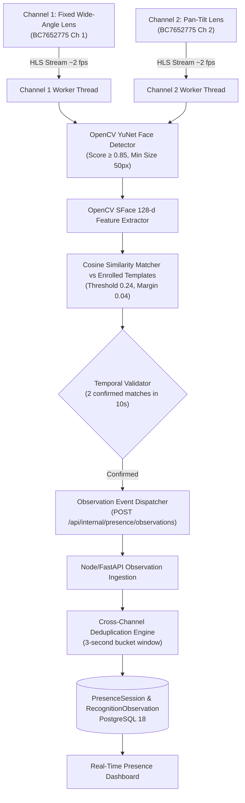
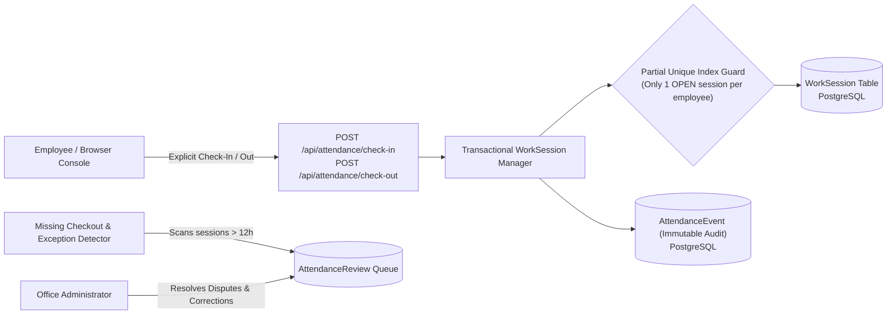

# WorkSight v2.0 Architecture Specification

## 1. Executive Summary & Design Principles

WorkSight v2.0 implements a **production-ready hybrid architecture** segregating employee monitoring into two logically independent systems:

1. **System A — Real-Time Employee Presence**: Observational, camera-driven face recognition evidence. It tracks physical in-office presence with explicit uncertainty states (`OBSERVED_RECENTLY`, `NOT_RECENTLY_OBSERVED`, `SENSOR_UNAVAILABLE`).
2. **System B — Hybrid Employee Attendance**: Authoritative, transactional work sessions (`WorkSession`, `AttendanceEvent`) requiring explicit employee Check-In / Check-Out actions or authorized administrator review.

> **CRITICAL ARCHITECTURAL RULE**: Face recognition evidence from cameras **NEVER** automatically creates an official attendance check-in or check-out. Disappearing from camera view does **not** falsely check an employee out.

---

## 2. System A: Real-Time Employee Presence Pipeline

### Presence Uncertainty State Machine:
- **`OBSERVED_RECENTLY`**: A verified match occurred within the freshness window (120 seconds).
- **`NOT_RECENTLY_OBSERVED`**: No verified match in the last 120 seconds. The employee is in an unmonitored zone, meeting room, or angled away. **Does not imply absence from building.**
- **`SENSOR_UNAVAILABLE`**: Camera feed dropped, stream token expired, or network disrupted.

---

## 3. System B: Hybrid Employee Attendance Architecture

### Key Business Rules:
1. **Single Open Session**: An employee can only have one active `OPEN` work session at any given time, enforced by a partial unique index in PostgreSQL (`uq_open_work_session_per_employee`).
2. **Multiple Daily Sessions**: Employees can log multiple valid work sessions per day (e.g. morning shift, off-site errand, evening shift).
3. **Idempotency**: All check-in and check-out requests accept an `idempotencyKey` to prevent double-submitting during network retries.
4. **Complete Non-Biometric Path**: Employees who decline face recognition have identical access to attendance check-in/out without penalty.
